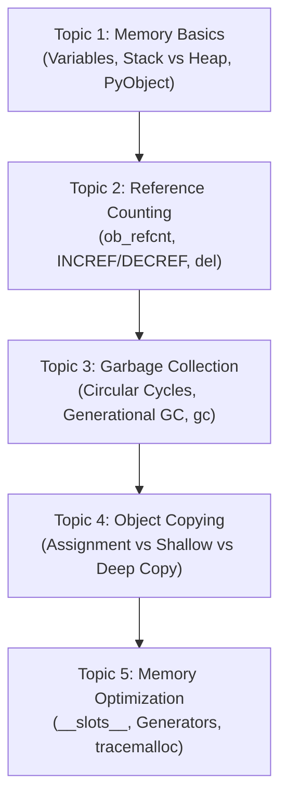
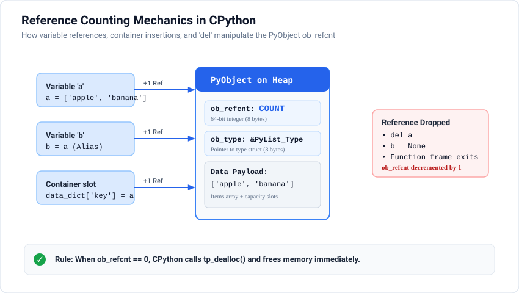
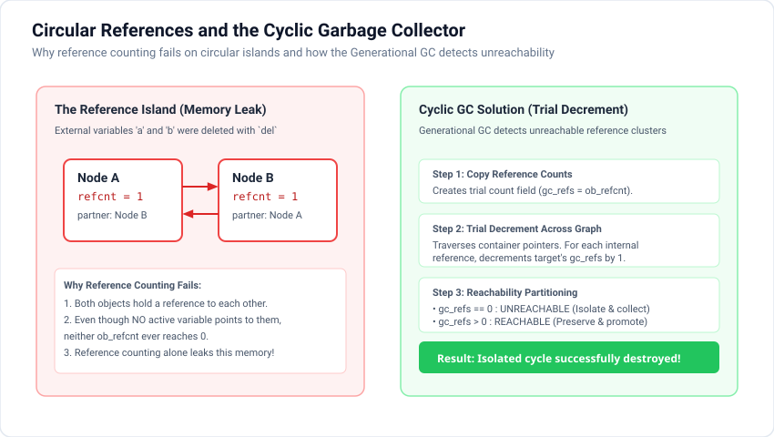

# Python Memory Management & Optimization Guide

**Author**: Navneet Saunee  
**Date**: November 2026  
**Level**: Beginner to Advanced | Production & System Design Reference  

Welcome to the comprehensive, beginner-friendly learning module on **Python Memory Management**. This module is designed to explain how Python (specifically the reference CPython implementation) handles memory, using relatable analogies, progressive Python examples, visual diagrams, and interview insights.

---

## 1. Introduction & Learning Objectives

In Python, memory management happens automatically behind the scenes. However, building scalable backend applications, high-performance data processing pipelines, and reliable services requires understanding how objects are stored, referenced, and collected.

### Learning Objectives
By completing this module, you will be able to:
1. Explain the distinction between the **Python language specification** and the **CPython reference implementation**.
2. Understand the **Call Stack** (variable references & frames) vs. the **Private Heap** (where all Python objects reside).
3. Trace **Reference Counting** mechanics, including why `sys.getrefcount()` includes a temporary function reference.
4. Understand how the **Cyclic Generational Garbage Collector** (`gc` module) finds and reclaims circular references.
5. Master object copying: distinguish between pointer **Assignment (`=`)**, **Shallow Copy (`copy.copy()`)**, and **Deep Copy (`copy.deepcopy()`)**.
6. Optimize memory in production using **`__slots__`**, generators, and memory profiling with **`tracemalloc`**.

---

## 2. Recommended Learning Sequence

Follow this structured 5-topic roadmap. Each topic contains an in-depth standalone Python file with runnable experiments and step-by-step output:



| Step | Topic & Script | Core Focus | Key Tools & Functions |
| :---: | :--- | :--- | :--- |
| **1** | [01_memory_basics.py](file:///mnt/c/Users/saune/Projects/python-scripts/Learning/Memory_Management/01_memory_basics.py) | Sticky notes model, Stack vs Heap, PyObject header | `id()`, `is`, `sys.getsizeof()` |
| **2** | [02_reference_counting.py](file:///mnt/c/Users/saune/Projects/python-scripts/Learning/Memory_Management/02_reference_counting.py) | How CPython tracks references, `del`, immediate cleanup | `sys.getrefcount()`, `__del__` |
| **3** | [03_garbage_collection.py](file:///mnt/c/Users/saune/Projects/python-scripts/Learning/Memory_Management/03_garbage_collection.py) | Circular references, Generational GC (Gen 0/1/2) | `gc.collect()`, `gc.get_threshold()` |
| **4** | [04_object_references_copying.py](file:///mnt/c/Users/saune/Projects/python-scripts/Learning/Memory_Management/04_object_references_copying.py) | Assignment vs Shallow copy vs Deep copy | `copy.copy()`, `copy.deepcopy()` |
| **5** | [05_memory_optimization.py](file:///mnt/c/Users/saune/Projects/python-scripts/Learning/Memory_Management/05_memory_optimization.py) | Slotted classes, lazy streams, memory profiling | `__slots__`, `tracemalloc` |

---

## 3. Visual Architecture & Memory Diagrams

The following architecture diagrams are located in [assets/](file:///mnt/c/Users/saune/Projects/python-scripts/Learning/Memory_Management/assets):

### 3.1 Python Memory Hierarchy
CPython divides memory management into multiple layers to avoid expensive OS system calls:


- **Layer +3 (User Application)**: High-level Python code (lists, dictionaries, custom objects).
- **Layer +2 (Type Allocators)**: Pre-allocated object freelists (Small integer cache `-5 to 256`, interned strings).
- **Layer +1 (pymalloc Core)**: The small-object allocator managing allocations $\le 512$ bytes in Arenas (256 KB) $\rightarrow$ Pools (4 KB) $\rightarrow$ Blocks (8 to 512 bytes).
- **Layer 0 (OS Virtual Memory)**: System `malloc()`, `free()`, and `mmap` for large objects ($> 512$ bytes).

---

### 3.2 Object Lifecycle
Every Python object progresses through four deterministic phases:


1. **Allocation**: `__new__` requests memory from a `pymalloc` pool and sets `ob_refcnt = 1`.
2. **Initialization**: `__init__` populates instance attributes in `self.__dict__`.
3. **Referencing**: Variables bind to the object address; passing to functions or placing in containers increments `ob_refcnt`.
4. **Deallocation**: When `ob_refcnt == 0`, `tp_dealloc` (and optional `__del__`) runs immediately, returning the memory block to the pool.

---

### 3.3 Reference Counting
Variables in Python are pointers (references) bound to heap objects, not boxes holding values:



---

### 3.4 Circular References & Cyclic Garbage Collection
Reference counting cannot collect circular reference islands. CPython's Generational GC isolates and reclaims them using a trial decrement algorithm:



---

## 4. Topic-by-Topic Walkthrough

### 4.1 Topic 1: Memory Basics
- **Relatable Analogy**: A variable is a sticky label with a name written on it. The object is the physical item sitting on a shelf in the warehouse (heap). You stick the label onto the item.
- In CPython, **all Python objects live on the private heap**.
- The **Stack** holds C execution frames and Python `PyFrameObject` structures containing local variable names and pointers.
- Every entity has a `PyObject` header containing `ob_refcnt` (8 bytes) and `ob_type` (8 bytes).

```python
import sys

x = 42
print(sys.getsizeof(x))  # 28 bytes (includes refcount + type pointer + payload)
```
*Run script:* `python 01_memory_basics.py`

---

### 4.2 Topic 2: Reference Counting in CPython
- **Relatable Analogy**: Like a library book checkout tally. Each reader who checks out or reserves the book adds a tally mark. When someone returns it, a tally mark is erased. When zero people have it checked out, the library shelves or recycles it.
- **The `sys.getrefcount()` quirk**: Passing an object into `sys.getrefcount(obj)` creates a temporary argument reference, making the result always **$+1$ higher** than expected.
- `del x` only unbinds the name `x`; the underlying object is only freed if its reference count drops to zero.

```python
import sys

data = ["alpha", "beta"]
print(sys.getrefcount(data))  # Prints 2 (1 for 'data', 1 temporary for getrefcount argument)
```
*Run script:* `python 02_reference_counting.py`

---

### 4.3 Topic 3: Garbage Collection & Circular References
- **Relatable Analogy**: Alice and Bob are on an isolated island holding each other's hands. Even if the bridge to the mainland collapses, each person still has 1 hand held. Reference counting alone cannot clean up the island because neither count reaches 0. The Cyclic GC is the rescue boat that surveys the whole island and reclaims it.
- CPython uses **Generational GC** based on the *Weak Generational Hypothesis* ("most objects die young"):
  - **Generation 0**: Youngest objects, scanned most frequently.
  - **Generation 1**: Intermediate survivors.
  - **Generation 2**: Long-lived objects, scanned least frequently.
- Atomic types (`int`, `str`, `bytes`) can never form reference cycles and are **never tracked** by cyclic GC.

```python
import gc

class Node:
    def __init__(self):
        self.partner = None

a, b = Node(), Node()
a.partner = b
b.partner = a
del a, b  # Cycle remains trapped in memory!

collected = gc.collect()  # Manually reclaims the unreachable cycle
print(f"Collected {collected} objects.")
```
*Run script:* `python 03_garbage_collection.py`

---

### 4.4 Topic 4: Object References and Copying
- **Relatable Analogy**:
  - **Assignment (`b = a`)**: Two people looking at the exact same physical sheet of paper on a desk.
  - **Shallow Copy (`copy.copy(a)`)**: Photocopying only the folder jacket, but leaving the original sheets inside. Modifying a sheet inside affects both!
  - **Deep Copy (`copy.deepcopy(a)`)**: Photocopying the folder and every single sheet of paper inside. Completely separate!

```python
import copy

nested = [[1, 2], [3, 4]]
shallow = copy.copy(nested)
deep = copy.deepcopy(nested)

shallow[0].append(99)  # Modifies both nested[0] and shallow[0]!
deep[1].append(88)     # Only modifies deep[1]; nested[1] is completely safe.
```
*Run script:* `python 04_object_references_copying.py`

---

### 4.5 Topic 5: Memory Optimization & Profiling
- **Relatable Analogy**:
  - **Generators vs Lists**: Lists are like buying 1,000,000 books upfront and stacking them in your living room. A generator is like a library card: you check out only the 1 book you are currently reading!
  - **`__slots__`**: Replacing a bulky cardboard shipping box (`__dict__`) with a sleek form-fitting case.
- **`__slots__`**: Eliminates the dynamic `__dict__` dictionary from class instances, saving **60%–70% RAM** when instantiating millions of objects.
- **`tracemalloc`**: Built-in profiler that traces memory allocations back to exact file and line numbers.

```python
class SlottedPoint:
    __slots__ = ('x', 'y')  # No __dict__ allocated!
    def __init__(self, x, y):
        self.x, self.y = x, y
```
*Run script:* `python 05_memory_optimization.py`

---

## 5. Frequently Asked Interview Questions

### Q1: Is Python call-by-value or call-by-reference?
**Answer**:
Python uses **call-by-object-reference** (or *call-by-sharing*). Arguments are passed as object references. If you reassign the parameter inside the function (`x = 10`), the local name points to a new object without affecting the caller. If you mutate a mutable object in-place (`x.append(10)`), the change is visible to the caller because both refer to the same object in memory.

### Q2: Why does `sys.getrefcount(obj)` return a count higher than my variables?
**Answer**:
`sys.getrefcount()` is a standard Python function. Passing `obj` into it binds the function's parameter argument, creating a temporary reference that increments the object's `ob_refcnt` by $1$ during function execution.

### Q3: Why doesn't Python immediately return freed memory back to the Operating System?
**Answer**:
CPython's `pymalloc` allocator manages memory in Arenas (256 KB) and Pools (4 KB). Returning memory to the OS requires freeing the entire 256 KB arena. If even one small object remains allocated in any pool inside the arena, the entire page must remain mapped. Additionally, retaining memory avoids the high CPU penalty of repeated kernel allocation system calls (`brk`/`mmap`).

### Q4: When should you use `__slots__`?
**Answer**:
Use `__slots__` when creating large numbers of instances of a data-heavy class (e.g., ORM models, point clouds, data records). It replaces the per-instance `__dict__` with a fixed-size C array of pointers, reducing memory by 60–70% and providing slightly faster attribute access.

### Q5: How does `copy.deepcopy()` handle circular references without an infinite loop?
**Answer**:
It maintains an internal `memo` dictionary mapping `id(original_object)` to the newly cloned copy. When it encounters an object that has already been cloned during the recursive walk, it immediately returns the cached copy instead of recursing infinitely.

---

## 6. Official Documentation References

- [Python Data Model (Objects, Values, and Types)](https://docs.python.org/3/reference/datamodel.html)
- [CPython Memory Management Architecture](https://docs.python.org/3/c-api/memory.html)
- [Standard Library: `gc` (Garbage Collector interface)](https://docs.python.org/3/library/gc.html)
- [Standard Library: `sys.getsizeof` & `sys.getrefcount`](https://docs.python.org/3/library/sys.html)
- [Standard Library: `tracemalloc` (Trace memory allocations)](https://docs.python.org/3/library/tracemalloc.html)
- [Standard Library: `copy` (Shallow and deep copy operations)](https://docs.python.org/3/library/copy.html)
