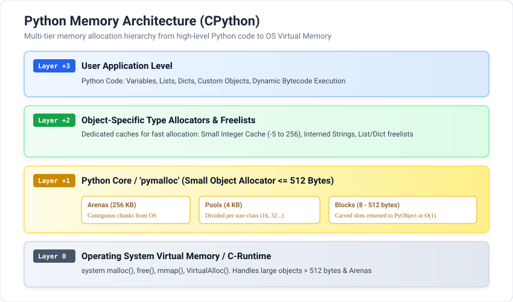
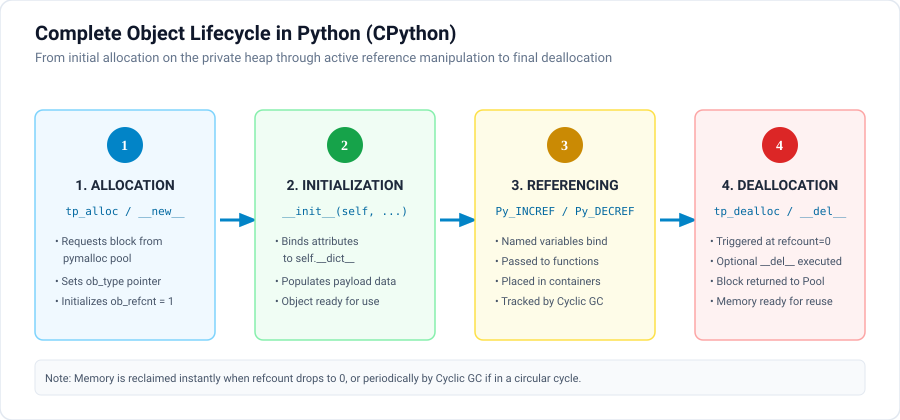

# Python Memory Management & Optimization Guide

**Author**: Navneet Saunee  
**Date**: November 2026  
**Level**: Beginner to Advanced | Production & System Design Reference  

Welcome to the comprehensive, standalone learning module on **Python Memory Management**. This module is designed to give you a deep, technically accurate, and practical understanding of how Python (specifically the reference CPython implementation) allocates, tracks, optimizes, and reclaims memory.

---

## 1. Module Overview & Learning Objectives

Memory management is often treated as "magic" in high-level languages like Python. However, writing high-throughput backend services, data processing pipelines, and scalable APIs requires a concrete understanding of what happens on the heap.

### Learning Objectives
By completing this module, you will be able to:
1. Explain the distinction between the **Python language specification** and the **CPython memory implementation**.
2. Understand the exact layout of a **`PyObject` struct** (reference counts, type pointers, and size descriptors).
3. Differentiate between the **Call Stack** (variable references/frames) and the **Private Heap** (where all Python objects reside).
4. Master **Object Identity** (`id()`, pointer equality `is`, and value equality `==`).
5. Trace **Reference Counting mechanics** and understand why `sys.getrefcount()` includes a temporary function reference.
6. Demystify the **Cyclic Generational Garbage Collector** (`gc` module, generations 0/1/2, and how trial decrement breaks circular islands).
7. Understand the difference between **Variable Assignment**, **Shallow Copies** (`copy.copy`), and **Deep Copies** (`copy.deepcopy`).
8. Detail CPython's multi-tiered **`pymalloc` architecture** (Arenas, Pools, and Blocks) and understand why deleting objects does not instantly return memory to the Operating System.
9. Implement production memory optimizations using **`__slots__`**, generators, homogeneous numeric arrays (`array.array`), weak references (`weakref`), and memory profiling via **`tracemalloc`**.

---

## 2. Recommended Learning Sequence

Follow this structured 7-topic roadmap. Each topic contains an in-depth standalone Python file complete with runnable demonstrations, benchmarks, and experiments:

```text
  [01: Overview] ───> [02: References & Identity] ───> [03: Reference Counting]
                                                              │
                                                              ▼
  [06: Allocator / pymalloc] <─── [05: Object Copying] <─── [04: Cyclic GC]
              │
              ▼
  [07: Memory Optimization & Profiling]
```

| Order | Topic Script | Primary Focus | Key Functions / Tools |
| :---: | :--- | :--- | :--- |
| **1** | [01_memory_management_overview.py](file:///mnt/c/Users/saune/Projects/python-scripts/Learning/Memory_Management/01_memory_management_overview.py) | CPython vs Spec, PyObject, Stack vs Heap | `sys.getsizeof()`, `inspect.currentframe()` |
| **2** | [02_object_references.py](file:///mnt/c/Users/saune/Projects/python-scripts/Learning/Memory_Management/02_object_references.py) | Variables as sticky labels, Mutability, Caching | `id()`, `is`, small int cache, `sys.intern()` |
| **3** | [03_reference_counting.py](file:///mnt/c/Users/saune/Projects/python-scripts/Learning/Memory_Management/03_reference_counting.py) | ob_refcnt, INCREF/DECREF, scope exits, `del` | `sys.getrefcount()`, `ctypes`, `__del__` |
| **4** | [04_garbage_collection.py](file:///mnt/c/Users/saune/Projects/python-scripts/Learning/Memory_Management/04_garbage_collection.py) | Circular references, Generational GC (Gen 0, 1, 2) | `gc.collect()`, `gc.get_threshold()`, `gc.disable()` |
| **5** | [05_object_copying.py](file:///mnt/c/Users/saune/Projects/python-scripts/Learning/Memory_Management/05_object_copying.py) | Assignment vs Shallow vs Deep copy | `copy.copy()`, `copy.deepcopy()`, memo dict |
| **6** | [06_memory_allocation.py](file:///mnt/c/Users/saune/Projects/python-scripts/Learning/Memory_Management/06_memory_allocation.py) | pymalloc (Arenas, Pools, Blocks), Process RSS | `sys.getsizeof()`, Linux `/proc/self/statm` |
| **7** | [07_memory_optimization.py](file:///mnt/c/Users/saune/Projects/python-scripts/Learning/Memory_Management/07_memory_optimization.py) | `__slots__`, arrays, weak references, profiling | `__slots__`, `array.array`, `weakref`, `tracemalloc` |

---

## 3. Architecture & Visual Diagrams

The following architecture diagrams are located in [assets/](file:///mnt/c/Users/saune/Projects/python-scripts/Learning/Memory_Management/assets):

### 3.1 Python Memory Hierarchy
CPython divides memory management into four distinct layers to avoid the heavy context-switching overhead of direct OS system calls:



- **Layer +3 (User Application)**: High-level Python code (lists, dictionaries, classes).
- **Layer +2 (Object Allocators)**: Pre-allocated object freelists (Small integer cache `-5 to 256`, interned strings).
- **Layer +1 (pymalloc Core)**: The small-object allocator managing allocations $\le 512$ bytes in Arenas (256 KB) $\rightarrow$ Pools (4 KB) $\rightarrow$ Blocks (8 to 512 bytes).
- **Layer 0 (OS Virtual Memory)**: C library `malloc()`, `free()`, and system memory calls (`mmap`, `VirtualAlloc`) for large allocations ($> 512$ bytes).

---

### 3.2 Object Lifecycle
Every Python object progresses through four deterministic phases:



1. **Allocation**: `__new__` requests memory from a `pymalloc` pool and sets `ob_refcnt = 1`.
2. **Initialization**: `__init__` populates instance attributes in `self.__dict__`.
3. **Referencing**: Variables point to the object; passing to functions or placing in containers increments `ob_refcnt`.
4. **Deallocation**: When `ob_refcnt == 0`, `tp_dealloc` (and optional `__del__`) runs immediately, returning the memory block to the pool.

---

### 3.3 Reference Counting
Variables in Python are pointers (references) bound to heap objects, not boxes holding values:


---

### 3.4 Circular References & Cyclic Garbage Collection
Reference counting cannot collect circular reference islands. CPython's Generational GC isolates and reclaims them using a trial decrement algorithm:


---

## 4. Topic-by-Topic Walkthrough & Code Examples

### 4.1 Topic 1: Memory Overview & Stack vs Heap
- In CPython, **all Python objects live on the private heap**.
- The **Stack** holds C execution frames and Python `PyFrameObject` structures containing local variable names and pointers.
- Every entity has a `PyObject` header containing `ob_refcnt` (8 bytes) and `ob_type` (8 bytes).

```python
import sys

x = 42
print(sys.getsizeof(x))  # 28 bytes (includes refcount + type pointer + payload)
```
*Run script:* `python 01_memory_management_overview.py`

---

### 4.2 Topic 2: Object References, Identity, and Mutability
- `id(obj)` returns the virtual memory address of the C struct in CPython.
- `a is b` checks pointer identity (`id(a) == id(b)`).
- `a == b` checks value equality (`a.__eq__(b)`).
- **CPython Optimization**: Integers between `-5` and `256` are pre-allocated singletons cached at interpreter startup.

```python
x = 100
y = 100
print(x is y)  # True (small integer cache)

large1 = int("1000")
large2 = int("1000")
print(large1 is large2)  # False (different heap objects)
print(large1 == large2)  # True (same values)
```
*Run script:* `python 02_object_references.py`

---

### 4.3 Topic 3: Reference Counting in CPython
- Reference counting is CPython's primary real-time memory manager.
- **The `sys.getrefcount()` quirk**: Passing an object into `sys.getrefcount(obj)` creates a temporary argument reference, making the result always **$+1$ higher** than expected.
- `del x` only unbinds the name `x`; the underlying object is only freed if its reference count drops to zero.

```python
import sys

data = ["alpha", "beta"]
print(sys.getrefcount(data))  # Prints 2 (1 for 'data', 1 temporary for getrefcount argument)
```
*Run script:* `python 03_reference_counting.py`

---

### 4.4 Topic 4: Cyclic Garbage Collection (`gc` Module)
- Cyclic GC exists solely to detect and break circular reference cycles that reference counting cannot clean.
- CPython uses **Generational GC** based on the *Weak Generational Hypothesis* ("most objects die young"):
  - **Generation 0**: Youngest objects, scanned most frequently.
  - **Generation 1**: Intermediate survivors.
  - **Generation 2**: Long-lived objects, scanned least frequently.
- Atomic types (`int`, `str`, `bytes`) can never form reference cycles and are **never tracked** by cyclic GC.

```python
import gc

class Node:
    def __init__(self):
        self.partner = None

a = Node()
b = Node()
a.partner = b
b.partner = a

del a, b  # Cycle remains in memory!
collected = gc.collect()  # Manually reclaims the unreachable cycle
print(f"Collected {collected} objects.")
```
*Run script:* `python 04_garbage_collection.py`

---

### 4.5 Topic 5: Object Copying (Assignment vs Shallow vs Deep)
- **Assignment (`b = a`)**: Shares the pointer. Modifying one modifies both.
- **Shallow Copy (`copy.copy(a)`)**: Duplicates the outer container, but child elements remain shared.
- **Deep Copy (`copy.deepcopy(a)`)**: Recursively duplicates the entire object hierarchy into fresh memory. Handles self-referencing loops safely using an internal memo dictionary.

```python
import copy

nested = [[1, 2], [3, 4]]
shallow = copy.copy(nested)
deep = copy.deepcopy(nested)

shallow[0].append(99)  # Modifies both nested[0] and shallow[0]!
deep[1].append(88)     # Only modifies deep[1]; nested[1] remains untouched.
```
*Run script:* `python 05_object_copying.py`

---

### 4.6 Topic 6: Memory Allocation (`pymalloc` & Process RSS)
- **Small Objects ($\le 512$ bytes)**: Managed by `pymalloc` without invoking OS system calls.
- **Large Objects ($> 512$ bytes)**: Handled directly by standard C `malloc()`.
- **Why Process RSS Doesn't Drop After `del`**:
  1. Python retains released memory in its internal pools for future allocations.
  2. An Arena (256 KB) can only be returned to the OS if **every single block across all 64 pools is completely vacant**. A single surviving byte pins the entire arena.

*Run script:* `python 06_memory_allocation.py`

---

### 4.7 Topic 7: Memory Optimization & Profiling
- **`__slots__`**: Eliminates the dynamic `__dict__` dictionary from class instances, saving **60%–70% RAM** when instantiating millions of objects.
- **`array.array`**: Stores raw C primitive numbers contiguously, avoiding Python's 28-byte integer wrapper overhead.
- **`weakref`**: References an object without increasing its reference count (ideal for caches and observers).
- **`tracemalloc`**: Built-in profiler that traces memory allocations back to exact file and line numbers.

```python
class SlottedPoint:
    __slots__ = ('x', 'y', 'z')  # No __dict__ allocated!
    def __init__(self, x, y, z):
        self.x, self.y, self.z = x, y, z
```
*Run script:* `python 07_memory_optimization.py`

---

## 5. Frequently Asked Interview Questions

### Q1: Is Python call-by-value or call-by-reference?
**Answer**:
Neither. Python uses **call-by-object-reference** (or *call-by-sharing*). Arguments are passed as object references. If you reassign the parameter inside the function (`x = 10`), the local name points to a new object without affecting the caller. If you mutate a mutable object in-place (`x.append(10)`), the change is visible to the caller because both refer to the same object in memory.

### Q2: Why does `sys.getrefcount(obj)` return a count higher than my variables?
**Answer**:
`sys.getrefcount()` is a standard Python function. Passing `obj` into it binds the function's parameter argument, creating a temporary reference that increments the object's `ob_refcnt` by $1$ during function execution.

### Q3: Why doesn't Python immediately return freed memory back to the Operating System?
**Answer**:
CPython's `pymalloc` allocator manages memory in Arenas (256 KB) and Pools (4 KB). Returning memory to the OS requires freeing the entire 256 KB arena. If even one small object remains allocated in any pool inside the arena, the entire page must remain mapped. Additionally, retaining memory avoids the high CPU penalty of repeated kernel allocation system calls (`brk`/`mmap`).

### Q4: When should you avoid using `__slots__`?
**Answer**:
1. When your class requires dynamic attribute assignment at runtime.
2. In complex multiple inheritance hierarchies where multiple parent classes have non-empty slots (this causes a `TypeError: multiple bases have instance lay-out conflict`).
3. When using tools or ORMs that depend on `instance.__dict__` for serialization.

### Q5: What is the difference between PyPy and CPython regarding memory management?
**Answer**:
CPython relies on **reference counting** as its primary mechanism, complemented by a cyclic generational garbage collector. PyPy does not use reference counting; it uses high-performance tracing garbage collectors (like IncMinimark) that eliminate reference counting overhead entirely and provide non-blocking compaction.

---

## 6. Official Documentation References

- [Python Data Model (Objects, Values, and Types)](https://docs.python.org/3/reference/datamodel.html)
- [CPython Memory Management Architecture](https://docs.python.org/3/c-api/memory.html)
- [Standard Library: `gc` (Garbage Collector interface)](https://docs.python.org/3/library/gc.html)
- [Standard Library: `sys.getsizeof` & `sys.getrefcount`](https://docs.python.org/3/library/sys.html)
- [Standard Library: `tracemalloc` (Trace memory allocations)](https://docs.python.org/3/library/tracemalloc.html)
- [Standard Library: `weakref` (Weak references)](https://docs.python.org/3/library/weakref.html)
- [Standard Library: `copy` (Shallow and deep copy operations)](https://docs.python.org/3/library/copy.html)
